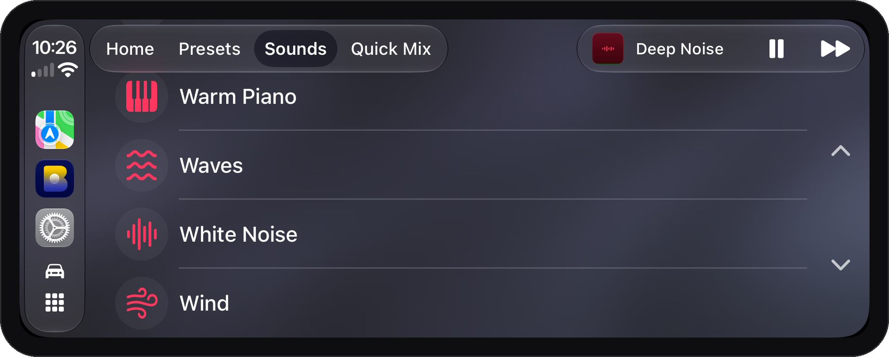
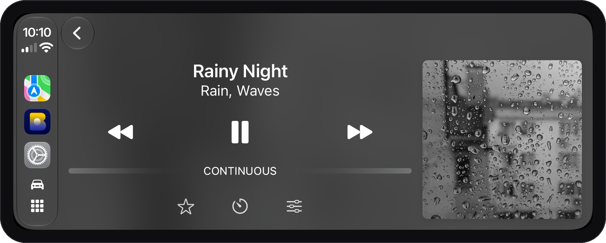
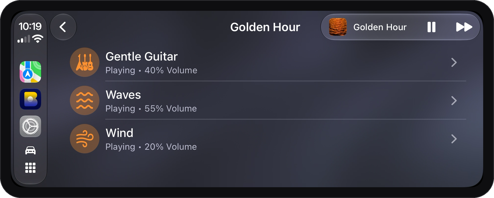
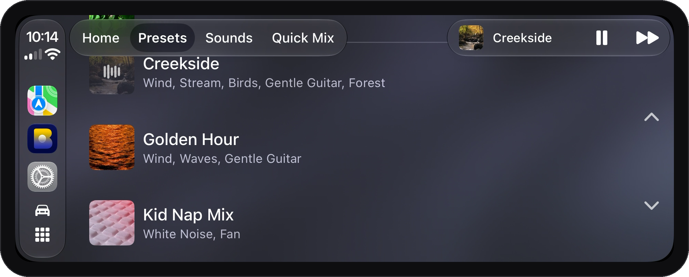

Long drive with a sleeping kid in the back? Highway hum proving to be the *wrong* kind of white noise? Blankie's CarPlay app puts your soundscapes on your dashboard and was built for selecting presets at a glance with a single tap.

{{review:carplay-standout}}

## What's on screen

Once Blankie is on your iPhone, it will [show up in CarPlay on its own](https://support.apple.com/guide/iphone/use-other-apps-with-carplay-iph206c570e3/ios). You'll see four tabs:

- **Home**: what's playing now (or your most recent mix) and your favorite presets and sounds right there. It's the fastest way back to things you listen to the most.
- **Presets**: **All Blankie Sounds** first, then all your presets, favorite or not, in alphabetical order. Tap one, it plays.
- **Sounds**: the full list of sounds. Tap any sound to play it on its own.
- **Quick Mix**: a soundboard for putting a mix together on the spot.

## Now Playing on the dashboard

Tap **Now Playing** in the top corner of CarPlay to reach the playback controls for your current mix:

- **Favorite** {{icon:star}}: star or unstar the current preset or sound so it stays on your **Home** tab.
- **Sleep Timer** {{icon:timer}}: set a countdown or cancel a running timer without picking up your phone.
- **Edit sounds** {{icon:sliders}}: when a preset is selected, tap the sliders button to turn that preset's sounds on or off from the dashboard.

## Set up before you drive

A little bit of prep in the app helps before you pull out of the driveway:

- **Make presets before you drive.** You can do some basic mixing in CarPlay, but it's a lot easier to pick from what's already made.
- **A good name makes it easy to find.** "Naptime Mix" is easier to find than "Preset 7."
- **[Star the items you reach for most.](/guides/create-and-manage-presets/)** Favorites appear in the Home tab in the order you put them, and your car's Previous and Next controls step through them while playing.

## It's still just Blankie

CarPlay drives the same playback as your phone. [Pause from the wheel](https://support.apple.com/guide/iphone/use-your-vehicles-built-in-controls-iph5f6b2beb5/ios), the dashboard or the phone itself and your mix stays right where you left it.

## Related guides

- [Create and Theme Presets](/guides/create-and-manage-presets/)
- [Quick Mix, Single Sounds and Presets](/guides/quick-mix-and-single-sounds/)
- [Control Blankie from Anywhere](/guides/control-blankie-anywhere/)
