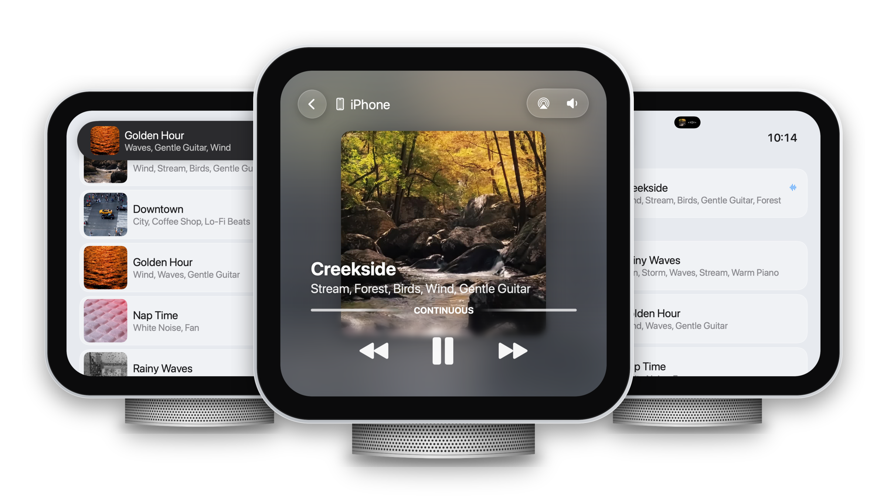
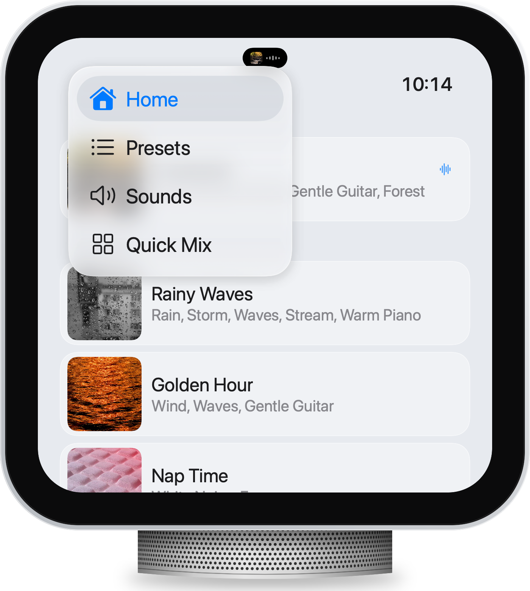
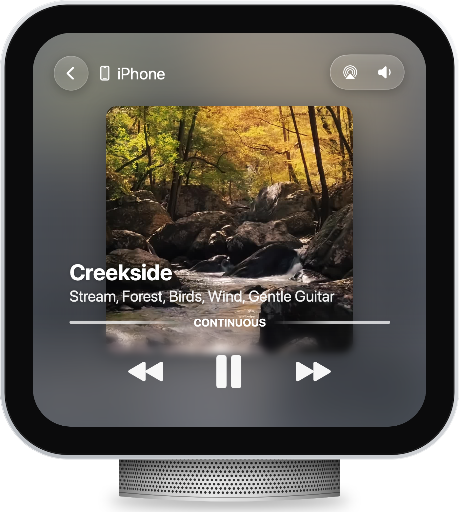

Just picked up a new Apple HomeView? Good news, Blankie is ready out of the box.

HomeView can run audio apps made for CarPlay but redraws them in its own style, so your mixes are ready to play from a kitchen counter or a nightstand. There's nothing to install on HomeView either. Blankie comes over from your iPhone with all your presets, favorites and sounds.

## How to get started

To make Blankie appear on your HomeView, you'll need to make sure a few things are in place:

- **Blankie on your iPhone.** Get it from the [App Store](https://apps.apple.com/us/app/blankie/id6740096581?platform=iphone) if you haven't yet.
- **Your iPhone paired, nearby and recently unlocked.** HomeView uses the same version of Blankie as your phone, so have your iPhone close by and on the same Wi-Fi network.
- **HomeView knows your face.** Each person in the household gets their own Home Screen, and HomeView needs to recognize you before your apps show up on yours.

## Find your way around

Blankie on HomeView has the same basic sections as [Blankie on CarPlay](/guides/blankie-carplay/). Tap the menu toggle in the top-left corner to switch between them:

- **Home**: your most recent mix, plus your favorite presets and sounds.
- **Presets**: with *All Blankie Sounds* first, then every preset in alphabetical order, each with its artwork and the sounds inside it. Tap one to play it.
- **Sounds**: your full list of built-in and imported sounds. Tap any sound to play it on its own.
- **Quick Mix**: big sound tiles for building a mix on the spot. (This isn't working properly on HomeView yet. See more under **Known issues** below.)

When you tap something playable from a list, HomeView opens it in **Now Playing**, just like CarPlay. Back out of it and that mix's artwork moves to the **Dynamic Island** at the top of the screen. When the island expands, it shows the mix's name and sounds, with pause and skip buttons. Tap the island anytime to get back to **Now Playing**.

Expect a short pause after each tap. HomeView sends every tap to your iPhone and waits for the sound to stream back, so playback may take a second or two to start. It's similar to how wireless CarPlay works in some cars, so don't worry if things feel a little sluggish sometimes.

## Now Playing

The **Now Playing** controls on HomeView work like they do on CarPlay and the Lock Screen. Pause stops what you're playing, and the back and forward buttons move through the [favorites you've set in Blankie](/guides/create-and-manage-presets/). Leave the screen alone for a few seconds and the controls fade away so the artwork fills the whole screen.

HomeView doesn't have volume buttons, so volume lives on the screen too. Tap anywhere on **Now Playing** to bring the controls back, then tap the volume button {{icon:speaker}} in the top-right corner.

For now, that's all that's possible with the first version of HomeView's software. The extra actions available in CarPlay (changing the volume of each sound in a preset, starring a preset or sound, or setting a **Sleep Timer**) aren't available on HomeView just yet. You can still do those on your iPhone and have them instantly reflected on HomeView, but hopefully a future HomeView software update will make it possible for you to do them right on the device.

## Widgets on HomeView

HomeView supports widgets, so you can have your favorite mix or sound one-tap away from your device's face or app drawer.

For now, HomeView only works with Blankie's small widgets for iPhone, which are the **Now Playing** and **Pinned Sound** widgets. You can add them to the "Modular" face or your app drawer, then tap them to jump back to Blankie or start your pinned preset or sound right away.

## Send Blankie to HomeView with AirPlay

You can also play Blankie through HomeView's speakers straight from your iPhone or iPad. Open **Now Playing** in Blankie, tap the **AirPlay** button and choose your HomeView. Your phone will handle all the mixing while HomeView does the playing, and you can control playback and volume from either device.

## Known issues with HomeView

As of launch day, Blankie is pretty capable but still experiencing a few limitations to be aware of:

- Quick Mix isn't working on HomeView. When you open it, the sound tiles show up, but none of them turn on or play. Starting a Quick Mix from your iPhone doesn't help either, and the tiles on HomeView stay unresponsive.
- Blankie can stop playing suddenly when you leave the app on HomeView, and some icons in lists show up at different sizes.

Fixes for these issues will be made available as soon as possible.

## It's still just Blankie

Even though HomeView brings Blankie to a new screen in your home, it doesn't change the core experience of the app. You're still getting the same mixes, sounds and presets that you love on your iPhone, just with a new way to interact with them.

Some things are still easier on your iPhone until HomeView's software adds more capabilities. As Apple adds more to HomeView, Blankie will continue to evolve and take advantage of any new opportunities to enhance the HomeView experience. But through all of it, Blankie will always stay free and open source.

## Related guides

- [Blankie on CarPlay](/guides/blankie-carplay/)
- [Fall Asleep with the Sleep Timer](/guides/sleep-timer/)
- [Create and Theme Presets](/guides/create-and-manage-presets/)
- [Control Blankie from Anywhere](/guides/control-blankie-anywhere/)
