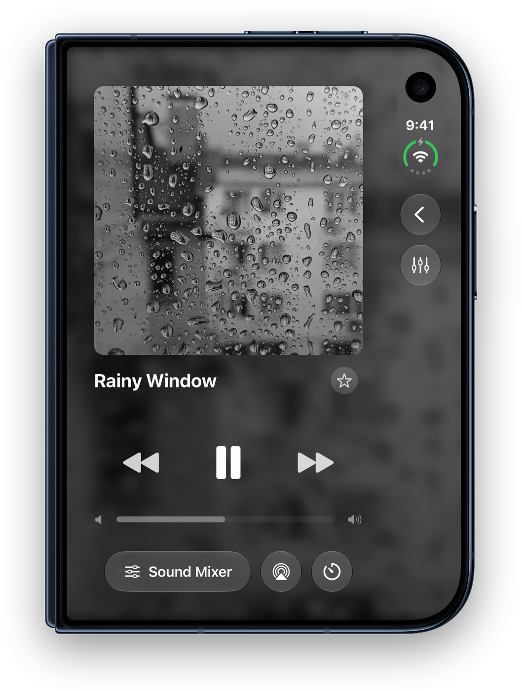
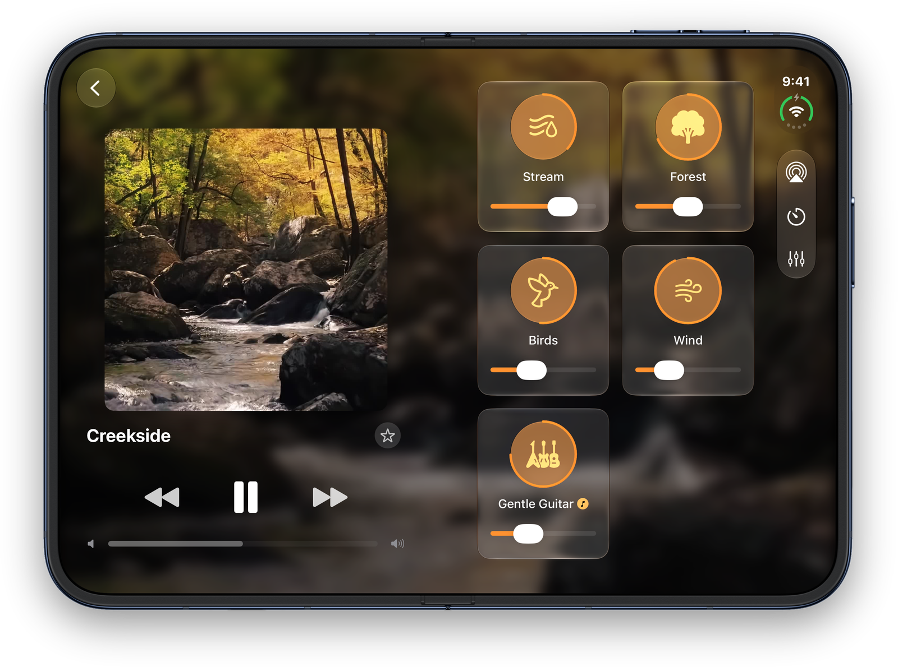
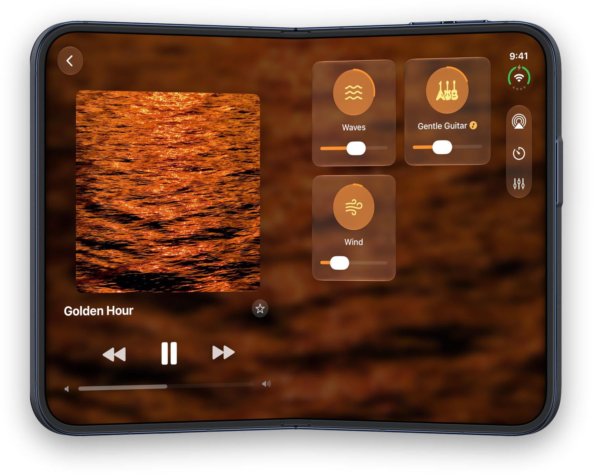
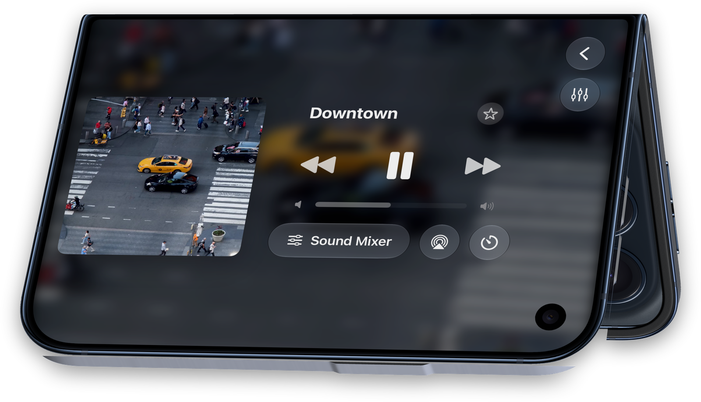
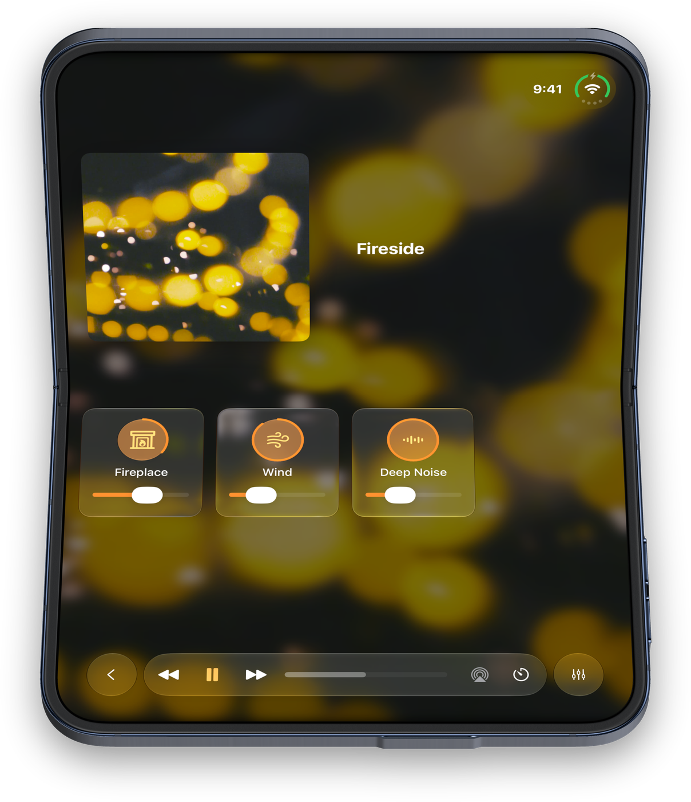
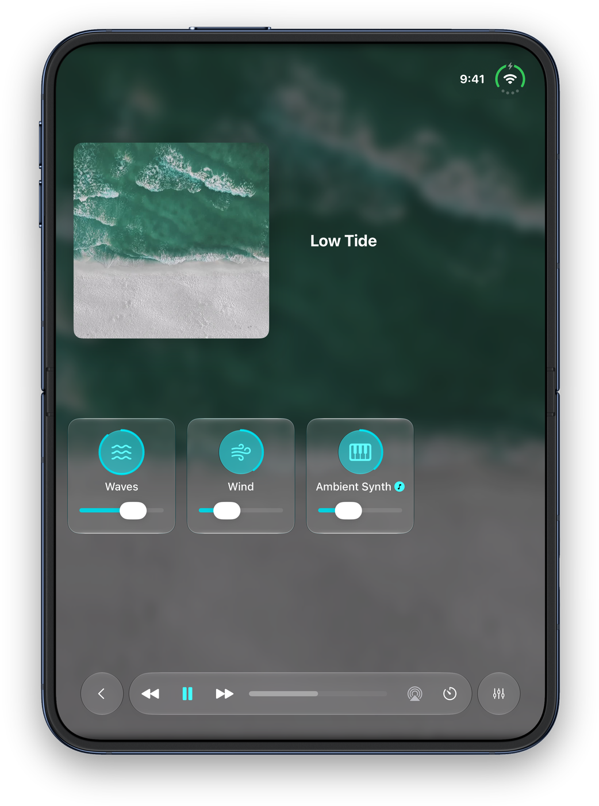

Blankie adapts its layout to how you hold or set down iPhone Duo, while keeping your audio playing uninterrupted whenever you fold, open or close the display.

## Closed

When closed, the outer display uses the standard iPhone layout: Now Playing up front, with the Sound Mixer, sleep timer and AirPlay right below the volume slider. Rotate the phone sideways and Now Playing switches to a two-column landscape view.

## Open flat

Unfold the phone and Blankie splits across the two halves of the screen:

- **Left page (Now Playing):** preset artwork, playback controls and volume. Tap the back arrow in the top corner to open your Library on this side.
- **Right page (Sound Mixer):** your sound tiles, with AirPlay, the sleep timer and edit buttons along the top bar.

While the Library is open on the left, Now Playing moves to the right page so you can still reach your playback controls. Select a preset or tap **Sound Mixer** to return to your tiles.

If you're playing a single sound on its own, Now Playing uses both pages with the artwork on the left and the controls on the right.

## Book posture

Fold the display partway and hold it like a book. Now Playing stays on the left page and the Sound Mixer stays on the right, with the hinge crease between them so sliders and buttons stay on the flat parts of the screen.

## Tent posture

Prop the phone half-open with the hinge at the top and the outer display facing you. Now Playing fills the screen in landscape, with your preset's artwork on one side and playback controls on the other.

## Seated nightstand mode

Set the phone down half-folded with the hinge running horizontally, like a tiny laptop on a desk or nightstand. Blankie stacks the layout across the two halves (you get the same stacked layout if you hold the unfolded phone in this orientation):

- **Upright half:** the artwork and title of what's playing, easy to read from across the pillow.
- **Flat half:** two rows of sound tiles and the bottom playback bar, keeping every button you tap on the half resting on the table.

Tap the back arrow on the left of the playback bar to swap the sound tiles for your Library on the flat half. Pick another preset and its tiles return.

## Editing presets and sounds

Tap the edit buttons above your sound tiles to open the sound or preset editor. Folding or unfolding the phone while an editor is open keeps the sheet open with your unsaved changes in place.

## Related guides

- [Control Blankie from Anywhere](/guides/control-blankie-anywhere/)
- [Fall Asleep with the Sleep Timer](/guides/sleep-timer/)
- [Create and Theme Presets](/guides/create-and-manage-presets/)
