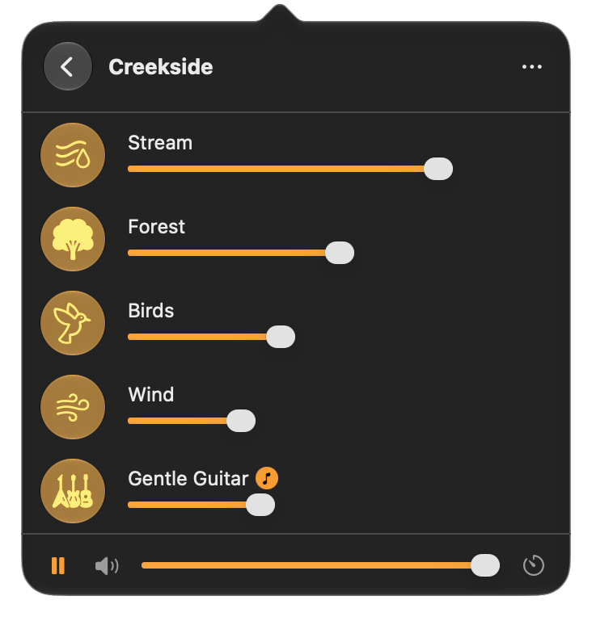
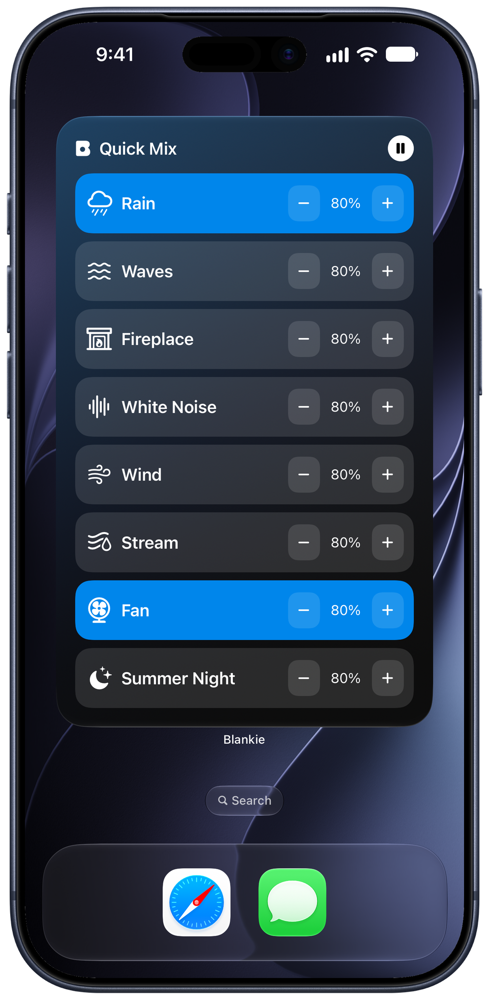
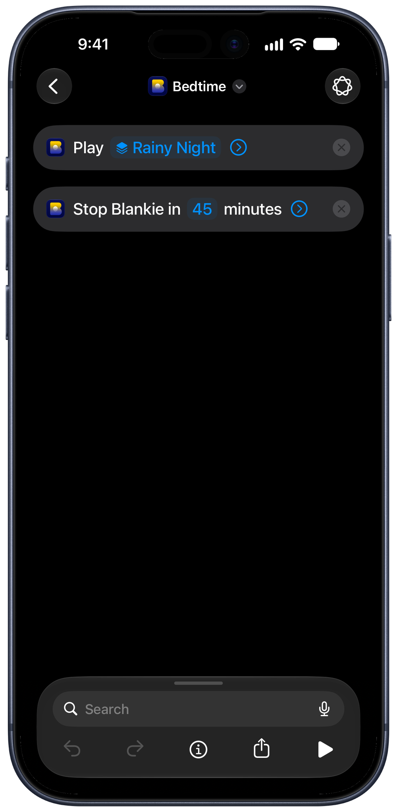

Blankie hooks into the system's Now Playing controls. Once your soundscape is going, you rarely need the app in front of you.

## On Mac

- **Blankie's menu bar app**: click the Blankie icon in the macOS menu bar to open a compact popover with your Library, per-sound volume sliders and the sleep timer, without bringing the main window forward. In **Settings → App**, you can also turn on **Menu Bar Only** or **Hide Dock Icon When Window Is Closed** to keep Blankie out of the Dock.
- **System Now Playing**: the [Now Playing item in the macOS menu bar](https://support.apple.com/guide/mac-help/quickly-change-settings-mchl50f94f8f/mac) also shows your active preset with play/pause right there.
- **Media keys**: the {{kbdicon:play-pause}} play/pause key on your keyboard controls Blankie like any music app. The {{kbdicon:rewind}} and {{kbdicon:fast-forward}} keys step through the presets and sounds you've marked as favorites.
- **Controls menu**: inside the app, the Controls menu plays and pauses, steps through your favorites and adjusts volume. The spacebar plays or pauses your whole mix too. The full list lives in [Blankie Keyboard Shortcuts for Mac](/guides/keyboard-shortcuts-mac/).

## On iPhone and iPad

- **Lock Screen**: your preset's name and [artwork](/guides/create-and-manage-presets/) show up with playback controls, the same as a music app.
- **Control Center**: the [Now Playing tile](https://support.apple.com/guide/iphone/use-the-music-player-controls-iph676daac9b/ios) plays and pauses your mix from anywhere.

## Home Screen widgets on iPhone and iPad

Touch and hold an empty area of your Home Screen, open the widget gallery and search for **Blankie**. Choose from four widgets:

| Widget | What it does | Sizes |
| --- | --- | --- |
| **Now Playing** | Shows the current sound or mix, with play/pause controls | Small |
| **Favorites** | Plays your starred presets and sounds | Medium, large, XL (iOS 27) |
| **Pinned Sound** | Keeps one preset or sound ready to play | Small |
| **Quick Mix** | Toggles your Quick Mix sounds on and off | Medium, large, XL (iOS 27) |

After adding **Pinned Sound**, touch and hold it, choose **Edit Widget** and select a preset or sound. For Favorites, star the items you want in Blankie; for Quick Mix, choose your [Quick Mix sounds](/guides/quick-mix-and-single-sounds/) in the app.

For Favorites and Quick Mix, touch and hold the widget and choose **Edit Widget** to set its **Color**. Choose **Default** to use the accent saved in Blankie's Settings, or choose a named color. Each widget keeps its own choice. iOS applies your Home Screen's Tinted or Clear treatment when enabled.

Pinned Sound and Now Playing use the artwork and accent of the preset or sound they display.

On iOS 27, the portrait **XL Favorites** widget shows up to 12 favorites with names. **XL Quick Mix** gives each sound its own row with **−** and **+** buttons so you can adjust its volume in 5% steps. Tap a sound tile to start Quick Mix; adjusting volume while paused leaves playback paused and doesn't change your saved presets.

## Siri on iPhone and iPad

Ask Siri to start a preset, a single sound or a sleep timer:

- **Play a preset:** say "Start a preset in Blankie," then say the preset's name when asked (such as "Lake Nights").
- **Play a sound:** say "Start a sound in Blankie," then say the sound's name when asked (such as "Rain").
- **Start a sleep timer:** say "Start a sleep timer in Blankie," then choose the duration.

**Play Sound** plays that single sound on its own without changing your saved presets. To pause or resume playback, use the Lock Screen, Control Center, a Blankie widget or a Shortcut with Blankie's Play or Pause action.

## Shortcuts on Mac, iPhone and iPad

In the **Shortcuts** app, add an action and search for **Blankie**. Actions include Play, Pause, Toggle Playback, Play Preset, Play Sound, Start/Stop Sleep Timer, Set Volume and Set Sound Volume. Pick a preset or sound in the action's menu and combine it with other steps:

- **Bedtime automation:** in the **Automation** tab on iPhone or iPad, set a personal automation for when **Sleep** Focus turns on, then add **Play Preset** followed by **Start Sleep Timer** set to 45 minutes.
- **Action Button or Control Center:** build a one-step shortcut with **Toggle Playback** or **Play Preset**, then assign it to the iPhone Action Button or a Control Center button.
- **Desk setup on Mac:** combine **Play Preset** with your window or Focus shortcuts so your work mix starts with the rest of your setup.

On iPhone and iPad, **Set Volume** requires **[Mix with Other Audio](/guides/mix-with-other-audio/)** to be turned on in Blankie's Settings. Otherwise, use your device's volume buttons. **Set Sound Volume** adjusts an individual sound's slider inside your mix.

## Spotlight on Mac, iPhone and iPad

Search Spotlight for the name of a preset or sound to find Blankie results (sounds marked **Preset Use Only** are hidden from Spotlight). To start a specific preset or sound directly, use its widget, Siri phrase or Shortcuts action.

## Headphones and CarPlay

[AirPods and other headphones with playback controls](https://support.apple.com/guide/airpods/use-controls-and-gestures-with-your-airpods-devb2c431317/web) pause and resume your mix without clearing your active sounds or volumes.

In the car, Blankie has a CarPlay app for switching presets, toggling sounds and setting a sleep timer from the dashboard. See [Blankie on CarPlay](/guides/blankie-carplay/).

## Related guides

- [Blankie on CarPlay](/guides/blankie-carplay/)
- [Fall Asleep with the Sleep Timer](/guides/sleep-timer/)
- [Blankie Keyboard Shortcuts for Mac](/guides/keyboard-shortcuts-mac/)
- [Play Blankie Alongside Music, Podcasts or Audiobooks](/guides/mix-with-other-audio/)
