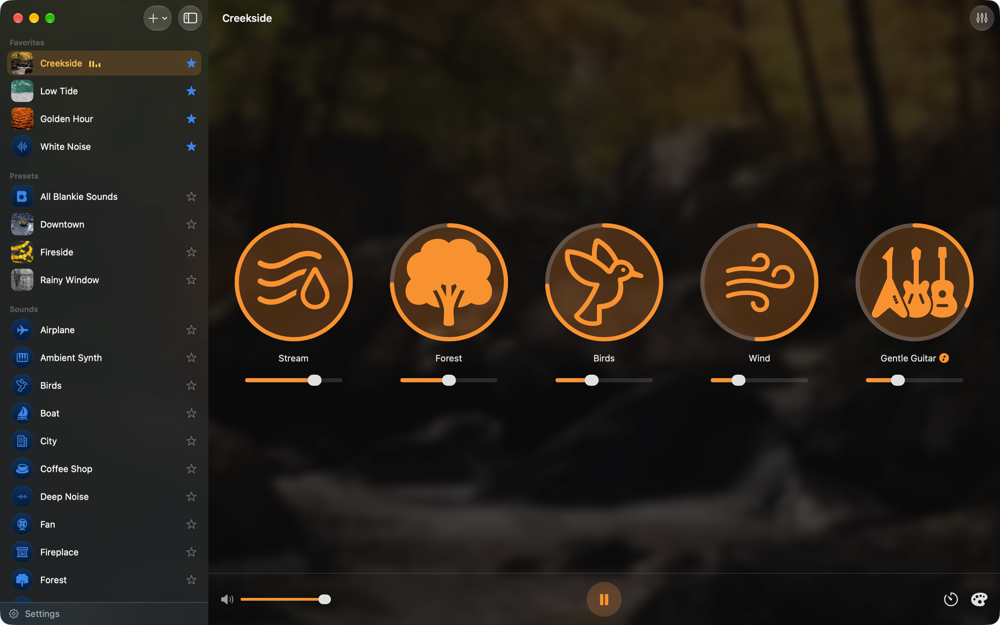
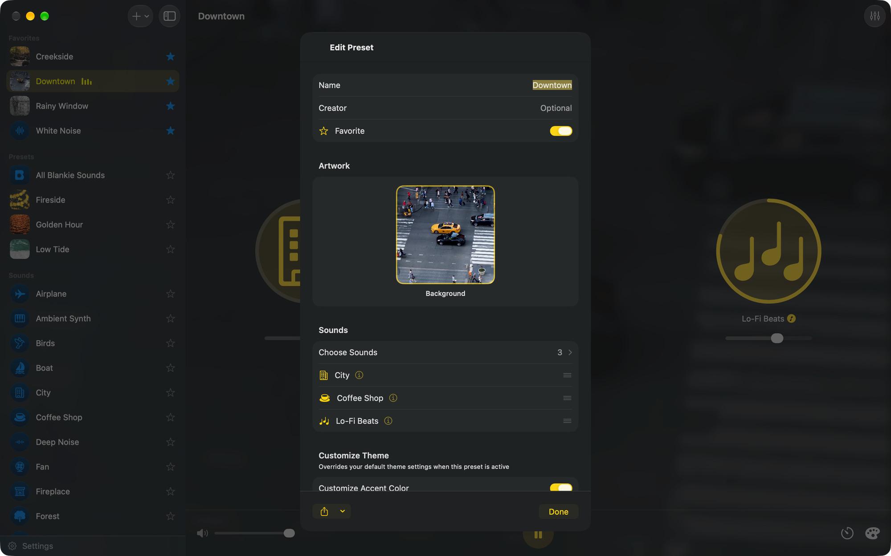
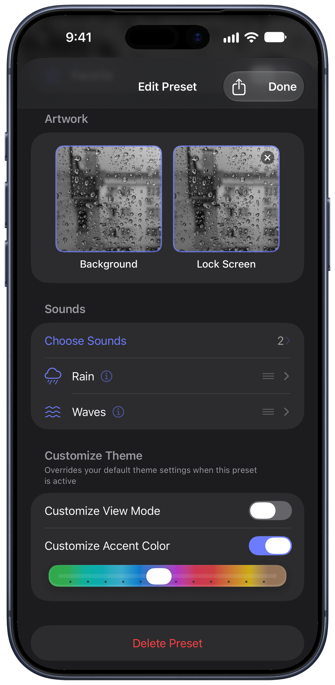
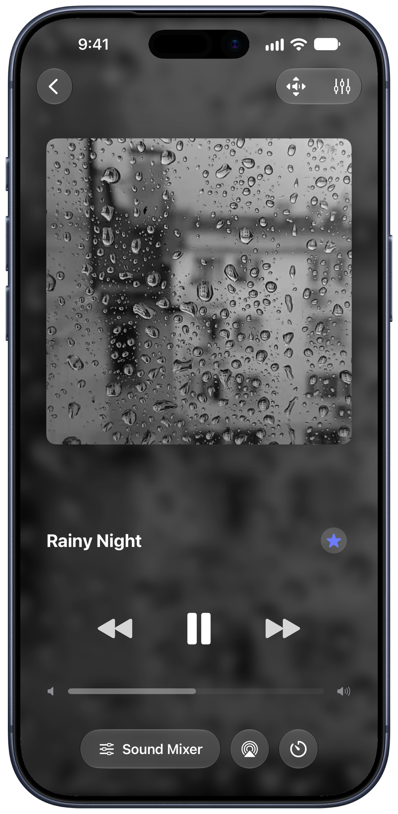
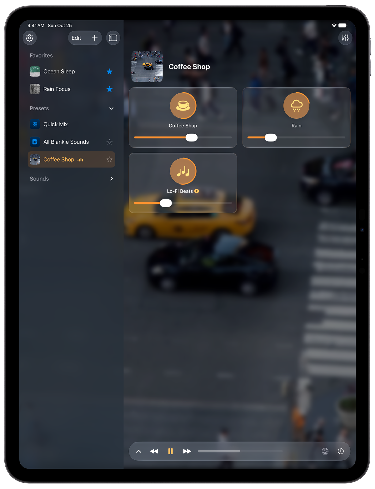

A preset in Blankie is just a mix of sounds with their volumes saved together. Maybe you like the sounds of the ocean and white noise for sleep, rain with piano while reading and sounds of the city paired with café sounds while you work. After you set them up, it takes just one click to switch between them. Every preset can also carry its own artwork and accent color, so the moment you switch mixes the app looks the part too.

## Create a preset

1. Click the {{icon:plus|Add}} button at the top of the sidebar (Mac and iPad) or in your Library (iPhone) and choose **New Preset**.
2. Tap **Choose Sounds** to pick what goes in it.
3. Give it a name. On devices with Apple Intelligence, tap the sparkles button in the **Name** field and Blankie will suggest a name based on the sounds you picked. You can add a creator name and artwork too.
4. Click **Create**.

> [!TIP]
> Already have something good going on the default preset? Hit its **Edit** button and Blankie will offer to spin up a new preset from whatever you've got playing.

## Edits save automatically

When a preset is active, anything you change (flipping sounds on or off, nudging volumes, dragging tiles to reorder them) gets saved to it right away. No save button to forget.

## Rename, edit or delete a preset

Right-click a preset on Mac, or touch and hold on iPhone and iPad, then choose **Edit Preset** or **Delete Preset**. The edit sheet handles the name, sound list and order, artwork and theme, all covered below.

The built-in default preset (**All Blankie Sounds**) can't be renamed or deleted, but it still takes custom artwork and theme settings.

## Add artwork

Open the preset's edit sheet (right-click → **Edit Preset** on Mac, touch and hold on iPhone and iPad). In **Artwork**, select the **Background** tile labeled **Add Image** to choose a photo. To replace it, select the tile again; use its remove button to clear the photo.

The background image follows the preset wherever it goes:

- The **Now Playing** screen and **Lock Screen** still artwork while the preset is playing
- The backdrop behind the mixer on Mac, iPhone and iPad
- The preset's thumbnail in your Library
- **CarPlay**, where artwork makes a preset easy to spot at a glance

On iPhone and iPad, the separate **Lock Screen** tile lets you browse animated artwork. You can keep both a background photo and an animation. If you choose an animation without a background photo, its still preview also supplies the mixer backdrop. Remove the animation with the Lock Screen tile's remove button.

## Customize Theme

The **Customize Theme** section takes over from your default theme whenever the preset is active:

- **Accent Color**: a color that tints the whole app while this preset plays (all platforms)
- **View Mode**: lock the preset to a Grid or List layout (iPhone and iPad)

Leave a toggle off and the preset just follows your app-wide settings.

On iPhone and iPad, **Blur Background Images** is an app-wide setting in **Settings**, rather than a per-preset control. On Mac, Blankie also displays a dimmed artwork backdrop, with no blur toggle in Settings.

## Favorites

Tap the **star** {{icon:star}} on any preset or individual sound row to drop it into the **Favorites** section at the top of your Library. You can drag to reorder favorites in Edit mode, step through them with your keyboard or headphone Previous and Next buttons and put them on your Home Screen with the Favorites widget or at the front of [CarPlay](/guides/blankie-carplay/).

Use a preset from a [Home Screen widget, Siri or Shortcuts](/guides/control-blankie-anywhere/) when you want it within reach outside the app.

## Related guides

- [Share Presets with Friends (.blankie Files)](/guides/share-presets/)
- [Quick Mix, Single Sounds and Presets](/guides/quick-mix-and-single-sounds/)
- [Control Blankie from Anywhere](/guides/control-blankie-anywhere/)
