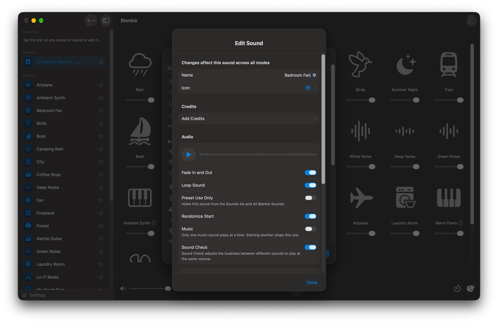
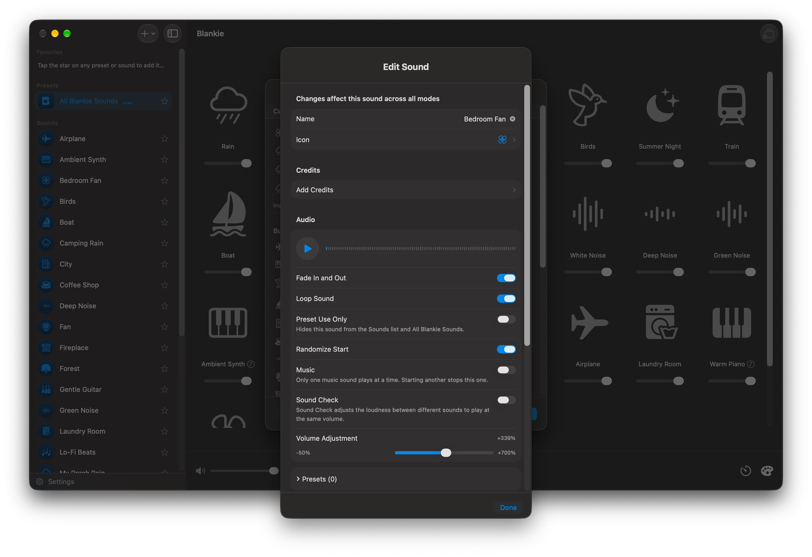

When you import a sound, or edit one later in **Manage Sounds**, Blankie gives you a set of controls that decide how it behaves in a mix and where it shows up in the app. Here's what each one does.

## Name and icon suggestions

When you pick a file to import on a device with Apple Intelligence, Blankie reads the filename and suggests a clean display name and a matching icon automatically. Tap the sparkles button beside **Name** or **Icon** to try another suggestion, or tap undo to go back to what you had.

## Fade In and Out

Gently fades the sound in when you start it and out when you pause or turn it off, instead of cutting in all at once. It's on by default. Very short clips always play without a fade so the start of the sound isn't swallowed.

## Loop Sound

Keeps the sound playing on repeat. It's on by default, which is what you want for most ambient audio. Turn it off for one-shot sounds meant to play once and stop, like a singing bowl or a chime.

## Preset Use Only

Hides the sound from the **Sounds** list in your Library, the **All Blankie Sounds** preset, Quick Mix, Siri and Spotlight. Use this for sounds that only make sense inside a specific preset you've built. Non-looping sounds always turn **Preset Use Only** on, since a one-shot clip can't loop on its own as a standalone sound.

## Randomize Start

Drops you into a different spot in the file every time the sound starts, so a loop doesn't begin with the exact same few seconds every session. This only applies when **Loop Sound** is on.

## Music

Marks a custom sound as a music loop. A preset only plays one music sound at a time, so starting another music loop automatically stops the one that was playing. Built-in music loops (**Ambient Synth**, **Gentle Guitar**, **Lo-Fi Beats** and **Warm Piano**) come with this tag turned on. Tag your own instrumental loops or songs the same way so they swap cleanly instead of playing on top of each other.

## Convert to AAC

When you import an uncompressed file like WAV or AIFF (or a large lossless file), Blankie offers a **Convert to AAC** toggle and estimates how much storage space you'll save. Turn it on to shrink the file with minimal quality loss. For audio files over 150 MB, **Convert to AAC** stays locked on so the import doesn't strain memory.

## Sound Check

Recordings from different microphones and websites vary wildly in volume. **Sound Check** measures a sound's loudness (using K-weighted LUFS analysis) and matches it to the rest of your library, so all of your sounds sit at a comparable level without you nudging sliders. It's on by default.

Turn Sound Check off and a **Volume Adjustment** slider takes its place, letting you push the sound's base level from -50% up to +700% by hand.

## Add to Presets

At the bottom of the import sheet, **Add to Presets** lets you drop your new sound straight into any of your saved presets, or check **New Preset** to spin up a fresh "[Sound Name] Mix" preset right away. When you edit a sound later, the **Presets** row shows how many custom presets include it and lets you check or uncheck them in place.

## Credits

If you grabbed a sound from somewhere, choose **Add Credits** in its settings after you import it to note its title, author, source URL and license. That's especially handy for [openly licensed audio, where attribution is part of the deal](https://creativecommons.org/share-your-work/cclicenses/). If your file carries metadata tags, like an [ID3 title and artist](https://id3.org/), Blankie reads them on import and fills these fields in for you.

## Changing settings later (including built-in sounds)

None of this is locked in. You can also edit Blankie's 24 built-in sounds the same way if you want to rename one, swap its icon, hide it with **Preset Use Only** or override its **Sound Check** level:

- **Mac:** choose **File → Manage Sounds**, press {{kbd:⌘ O}} or open **Settings → Manage Sounds**, then select the sound to edit.
- **iPhone and iPad:** open **Settings → Manage Sounds**, then tap the sound to edit.

Every sound's edit sheet has a **Reset to Defaults** button at the bottom if you ever want to put its original settings back.

## Related guides

- [Import Your Own Sounds on Mac](/guides/import-sounds-mac/)
- [Import Your Own Sounds on iPhone & iPad](/guides/import-sounds-iphone-ipad/)
- [Turn Voice Memos Into Ambient Sounds](/guides/import-voice-memos/)
- [Create and Theme Presets](/guides/create-and-manage-presets/)
