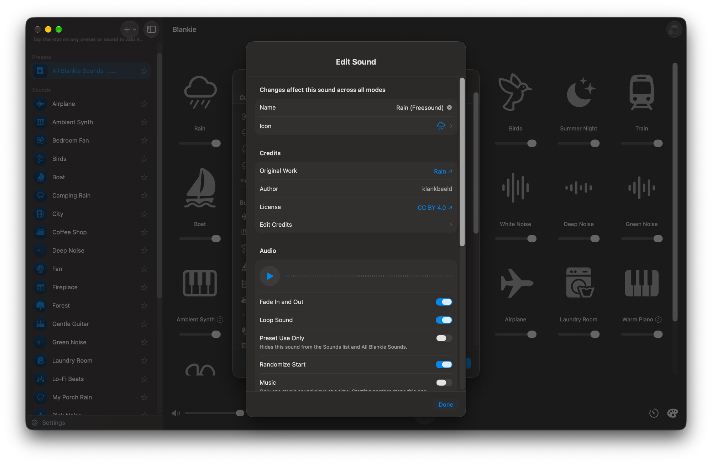

[Freesound](https://freesound.org) is a community library of hundreds of thousands of Creative Commons recordings and one of the best places to find new sounds for Blankie. A lot of Blankie's built-in sounds started life there.

## Find a sound

1. Search for what you want to hear. Try terms like **"rain loop,"** **"forest ambience,"** **"cafe field recording"** or **"thunderstorm."**
2. Use the filters to narrow things down:
   - **License**: filter to **[Creative Commons 0](https://creativecommons.org/publicdomain/zero/1.0/)** if you'd rather not deal with attribution at all.
   - **Duration**: longer recordings (one minute or more) loop more naturally in Blankie.
3. Preview right on the page until something clicks.

## Download it

Downloads need a free Freesound account. Files come in whatever format the uploader picked (WAV, FLAC, OGG, MP3 or AIFF), and Blankie imports every one of them directly.

> [!TIP]
> Blankie can import these directly with no size limit to worry about, but files over 150 MB are converted to AAC automatically as they import to conserve memory.

## Import and credit

1. Import the file into Blankie ([Mac](/guides/import-sounds-mac/) / [iPhone and iPad](/guides/import-sounds-iphone-ipad/)).
2. Once it's imported, open the sound's [settings](/guides/custom-sound-settings/#changing-settings-later-including-built-in-sounds) and choose **Add Credits**. Fill in the author's username, a link back to the Freesound page and the [license](https://freesound.org/help/faq/). If the file carries metadata tags, Blankie fills in what it can for you.

Crediting matters most for **CC BY** sounds, since those require attribution. It's also just the decent thing to do for any sound, especially once you [share the preset](/guides/share-presets/) with friends. Our [license guide](/guides/sound-licenses-explained/) has the details.

## Related guides

- [Where to Find Free Ambient Sounds](/guides/find-free-ambient-sounds/)
- [Common Sound Licenses, Explained](/guides/sound-licenses-explained/)
- [Custom Sound Settings: Loop, Sound Check & Credits](/guides/custom-sound-settings/)
