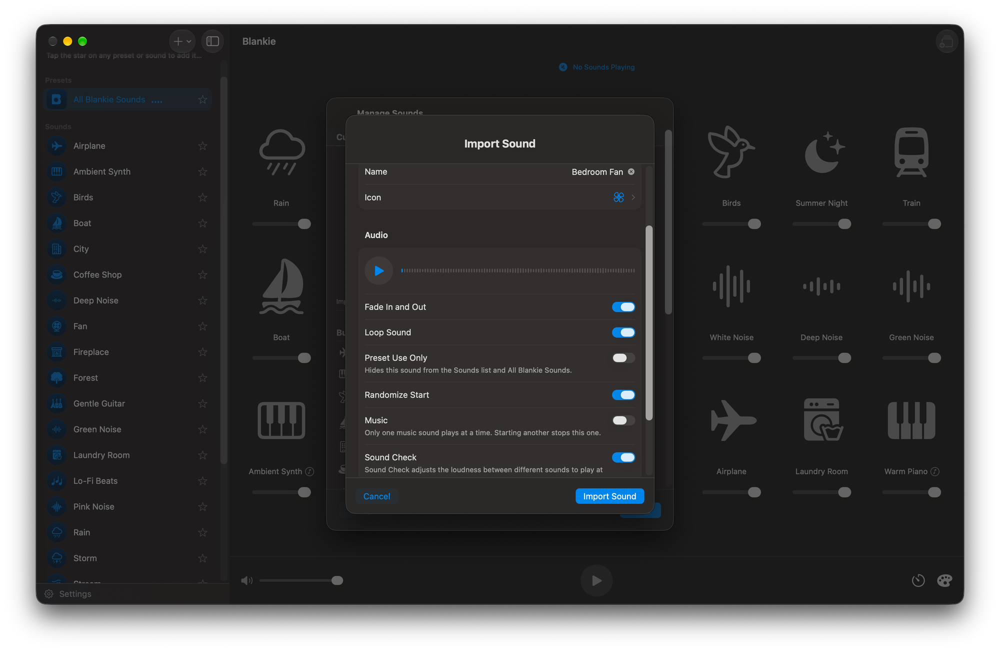

Blankie comes with 24 curated ambient sounds but you can [import your own](/guides/import-sounds-mac/) whenever you want more. So where do you get more? Here are the places I trust for good audio that's free and legal to use.

## Freesound

[Freesound](https://freesound.org) has hundreds of thousands of field recordings, loops and ambient sounds under various Creative Commons licenses. A lot of Blankie's own built-in sounds came from here. You'll need a free account to download. Check out the [step-by-step Freesound guide](/guides/download-sounds-from-freesound/) if you want the full walkthrough.

## Pixabay

[Pixabay's sound effects library](https://pixabay.com/sound-effects/) has thousands of ambiences and loops under a [permissive license](https://pixabay.com/service/license-summary/) that's fine for personal use, but wouldn't hold up if you wanted to create and distribute Blankie preset packs.

## BBC Sound Effects

The [BBC Sound Effects archive](https://sound-effects.bbcrewind.co.uk) holds more than 33,000 professional recordings, from steam trains to rainforests. The sounds are free for personal and educational use under the BBC's [RemArc license](https://sound-effects.bbcrewind.co.uk/licensing), but not for commercial projects.

## NASA

Rocket launches, radio emissions from Jupiter, the ambient hum of the International Space Station. [NASA's audio collections](https://soundcloud.com/nasa/sets/) are [largely public domain](https://www.nasa.gov/nasa-brand-center/images-and-media/) and some of it makes for weirdly excellent sleep material.

## Wikimedia Commons & Internet Archive

[Wikimedia Commons](https://commons.wikimedia.org) and the [Internet Archive](https://archive.org) both host huge collections of openly licensed and public-domain recordings. Quality can be all over the place, but there are real gems in there. Check each file's license before you redistribute or try to sell anything using them, and most importantly, use common sense. Archive.org in particular has a lot of content uploaded by someone who is not the copyright owner, so any license you see listed should be taken with a grain of salt.

## What to download

Blankie imports most audio formats, such as M4A, MP3, WAV, FLAC, AIFF, OGG and more. Almost anything these sites hand you works as-is. There's no size limit to worry about, but files over 150 MB are converted to AAC automatically to preserve memory.

Wherever you grab a sound, take note of its license. Some ask for credit, and Blankie has built-in [Credits fields](/guides/custom-sound-settings/) made for exactly that. Our [license guide](/guides/sound-licenses-explained/) breaks down what each one actually means.

## Related guides

- [Download Sounds from Freesound](/guides/download-sounds-from-freesound/)
- [Common Sound Licenses, Explained](/guides/sound-licenses-explained/)
- [Record Your Own Ambient Sounds](/guides/record-your-own-ambient-sounds/)
