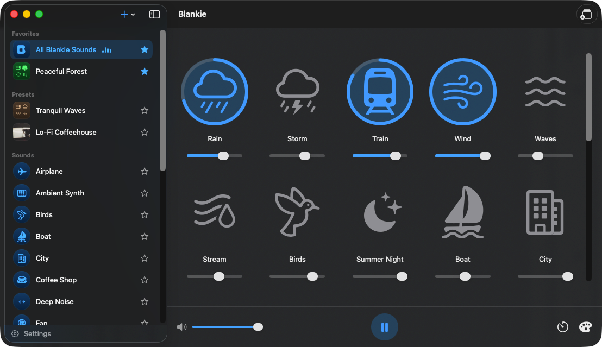

Blankie is an ambient sound mixer. Pick the sounds you want (a fan to fall asleep to, rain to focus, a coffee shop for a too-quiet room) and set each to its own volume until the mix is just the way you like it. Getting your first mix set up usually takes about a minute.

## Play your first sound

Start by navigating to the **All Blankie Sounds** option in the Library (this is the sidebar on Mac or iPad; on iPhone you may need to press the back icon in the top left first). If no sounds are playing, tap or click any tile to start it. On iPhone, the tiles live in the **Sound Mixer**: tap its button under the volume slider to open it.

To stop playing a sound, tap it again. To temporarily stop all sounds, press the pause button. Pausing keeps your mix intact, so when you come back, every sound and volume stays right where you left it.

## Build a mix

Turn on a few more sounds. Each playing sound has its own volume slider for you to balance however you like:

- Set your main sound to a comfortable volume and keep the others quieter in the background.
- **Two to six sounds is the sweet spot.** Add too many more after that and they can start to blur together.

## Save it as a preset (or keep it casual)

Built a mix you like? If you're on the **All Blankie Sounds** preset, you can save your work as its own **preset** so it's one tap away next time. Tap the edit icon in the top right corner of Blankie (on iPhone, the top right of Now Playing or the Sound Mixer). A preset keeps a group of sounds and their volumes together with a name, artwork and an accent color of its own. See [Create and Theme Presets](/guides/create-and-manage-presets/) for more information.

Don't need a full preset? You can also tap any single sound in the **Sounds** section of your Library to play it on its own, or use **Quick Mix** on iPhone, iPad and CarPlay as a lightweight soundboard. See [Quick Mix, Single Sounds and Presets](/guides/quick-mix-and-single-sounds/) for how the three modes fit together.

## Next, learn how to do even more

- **[Import your own sounds.](/guides/import-sounds-mac/)** Your fan, rain on your own roof, anything. Imported sounds can mix right alongside built-in sounds.
- **[Set a sleep timer.](/guides/sleep-timer/)** Drift off and Blankie pauses itself.
- **[Control it from anywhere.](/guides/control-blankie-anywhere/)** Widgets, Siri, Shortcuts, media keys, the Lock Screen, AirPods and CarPlay.

## Related guides

- [Quick Mix, Single Sounds and Presets](/guides/quick-mix-and-single-sounds/)
- [Create and Theme Presets](/guides/create-and-manage-presets/)
- [Import Your Own Sounds on Mac](/guides/import-sounds-mac/)
