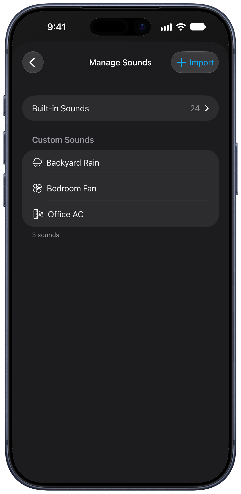

Blankie ships with a curated library of ambient sounds, but it's just as happy playing yours. If you can save it to the [Files app](https://support.apple.com/guide/iphone/files-basics-iphe9d46e90f/ios), you can turn it into a Blankie sound: something you downloaded, [AirDropped over from another device](https://support.apple.com/guide/iphone/use-airdrop-to-send-items-to-nearby-devices-iphcd8b9f0af/ios) or exported from another app.

## Import a sound

1. Tap the {{icon:plus|Add}} button in your Library and choose **Import**. (You can also head to **Settings → Manage Sounds** and tap **Import**.)
2. The file browser opens. Grab any audio file from On My iPhone, iCloud Drive or another storage provider in the Files app.
3. On the import sheet, give your sound a name, pick an icon and have a listen.
4. Tap **Save**. It lands right next to the built-in sounds, ready to mix.

## Supported formats and limits

- **Formats:** M4A (AAC or Apple Lossless), MP3, WAV, FLAC, AIFF, OGG (Vorbis or Opus), CAF, AAC and AU. Windows Media (WMA) files aren't supported.
- **Size:** no limit to worry about. Files over 150 MB are converted to AAC automatically as they import to conserve memory.

Import as many sounds as you like. They live on your device and stay there. Nothing gets uploaded anywhere.

## Automatic volume matching

Import a sound and Blankie measures its loudness, then quietly matches it to the rest of the library (this is called **Sound Check**). Your new sound slots into a mix without you riding the volume sliders. Want to tune that yourself? See [Custom Sound Settings](/guides/custom-sound-settings/) for looping, randomized start and manual volume adjustment.

## Editing and removing imported sounds

Everything you've imported lives in **Settings → Manage Sounds**. Open it to rename a sound, swap its icon, change its options or clear out the ones you've moved on from.

## Related guides

- [Turn Voice Memos Into Ambient Sounds](/guides/import-voice-memos/)
- [Import Your Own Sounds on Mac](/guides/import-sounds-mac/)
- [Custom Sound Settings: Loop, Sound Check & Credits](/guides/custom-sound-settings/)
