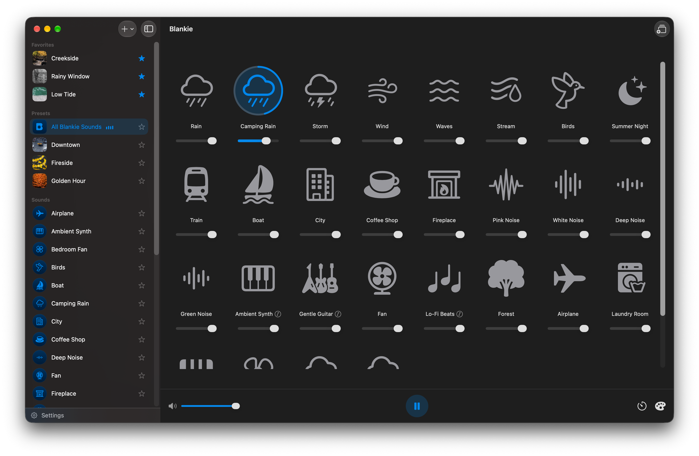

Blankie comes with a curated library of ambient sounds, but you're not stuck with just those. Blankie gets even better when you add more. That voice memo of rain you recorded on a camping trip, that song you can't stop listening to, maybe even a class lecture. Whatever audio is already sitting on your Mac, you can add to Blankie.

## Import a sound

1. Choose **File → Import**, or press {{kbd:⌘ I}}, or click the {{icon:plus|Add}} button at the top of the sidebar and choose **Import**.
2. Pick an audio file from your Mac using the file browser.
3. Blankie will open an import sheet where you can give your sound a name, pick an icon and have a listen before you commit.
4. Click **Import Sound**. Your new sound shows up next to the built-in ones, ready to drop into a mix.

You can also choose **Blankie → Settings**, or press {{kbd:⌘ ,}}, then click **Manage Sounds** and hit **Import** from there.

## Supported formats and limits

- **Formats:** M4A (AAC or Apple Lossless), MP3, WAV, FLAC, AIFF, OGG (Vorbis or Opus), CAF, AAC and AU. Just about anything that plays on your Mac imports. The only common format Blankie can't read is Windows Media Audio (WMA). Just [convert it somewhere else first](/guides/convert-audio-files/) and bring it into Blankie.
- **Size:** no limit to worry about. Files over 150 MB are converted to AAC automatically as they import.

Import as many sounds as you like. They're yours, and they stay on your device.

## Automatic volume matching

Recordings from different devices and apps can vary wildly in volume. So Blankie measures the loudness of each sound you import and matches it to the rest of your library. Blankie calls this feature **Sound Check**, and it means a new sound sits at a comparable level in a mix instead of blasting or vanishing, with no slider-riding from you. To turn it off and set a sound's level by hand, see our guide on [custom sound settings](/guides/custom-sound-settings/).

## Related guides

- [Import Your Own Sounds on iPhone & iPad](/guides/import-sounds-iphone-ipad/)
- [Turn Voice Memos Into Ambient Sounds](/guides/import-voice-memos/)
- [Custom Sound Settings: Loop, Sound Check & Credits](/guides/custom-sound-settings/)
