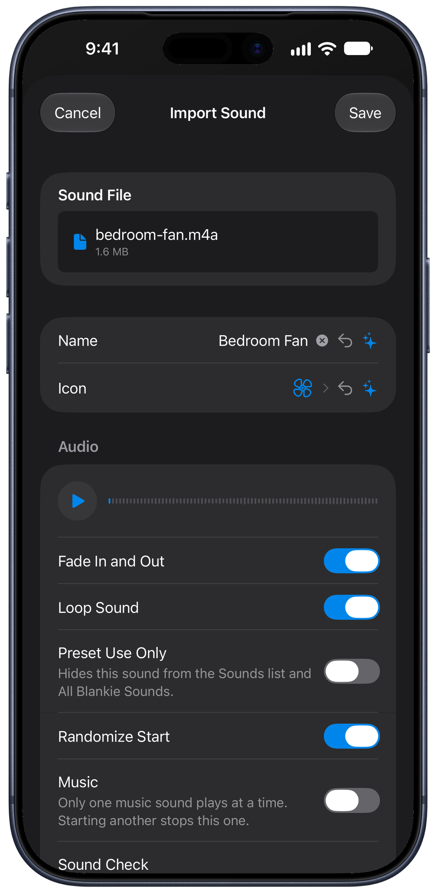
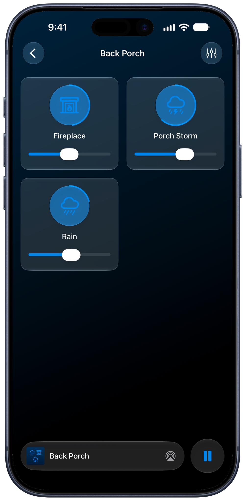

A thunderstorm you caught from the porch, the crackle of the campfire last summer and the hum of your favorite café belong in your mix. The Voice Memos app on your phone exports recordings in a format that Blankie can use natively, so you can go straight from recording to soundscape without converting or transferring.

## On iPhone or iPad

1. Open **Voice Memos** and tap the recording you want.
2. Tap the **More** button {{icon:more}}, then tap the **Share** button {{icon:share}}.
3. Scroll down, [tap **Save to Files**](https://support.apple.com/guide/iphone/export-a-recording-to-files-iph831c37815/ios) and drop it somewhere you'll be able to find again.
4. Over in Blankie, tap {{icon:plus|Add}} **→ Import** and pick the recording you just saved.
5. Give it a name and an icon, then tap **Save**.

## On Mac

1. Drag the recording out of the **Voice Memos** app and into a folder, or onto your desktop.
2. In Blankie, choose **File → Import**, or press {{kbd:⌘ I}}, then pick the recording.
3. Give it a name and an icon, then click **Import Sound**.

## Tips for great loops

- **Record a minute or more.** The longer you capture, the less often you'll hear where the loop starts over.
- **Don't sweat perfect levels.** Blankie matches your recording's loudness to the rest of the library for you, so even a mostly quiet phone recording will play evenly in a mix.
- **Trim first.** Got some fumbling at the start or end? [Clean it up in Voice Memos](https://support.apple.com/guide/iphone/edit-or-delete-a-recording-iphc9bdaee83/ios) before you import. Tap the recording, tap the **More** button {{icon:more}}, tap **Edit Recording**, then tap the **More** button {{icon:more}} in the top left corner and choose **Trim**. Just drag the yellow handles around the part you want to keep.

Once your trimmed recording is imported, read on about how you can use [Custom Sound Settings](/guides/custom-sound-settings/) to tweak it to your liking.

## Related guides

- [Import Your Own Sounds on iPhone & iPad](/guides/import-sounds-iphone-ipad/)
- [Import Your Own Sounds on Mac](/guides/import-sounds-mac/)
- [Custom Sound Settings: Loop, Sound Check & Credits](/guides/custom-sound-settings/)
