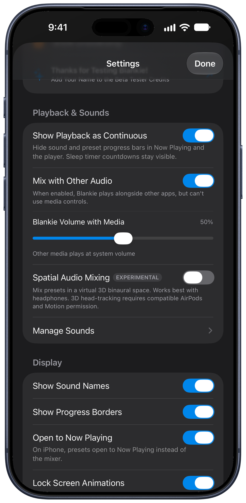

On iPhone and iPad, Blankie behaves like a music app. Starting it pauses whatever else was playing, and Blankie takes over the Lock Screen, Control Center and your headphone buttons. Want rain under an audiobook or podcast instead? Turn on Mix with Other Audio and Blankie plays alongside your other apps.

## On iPhone and iPad: Mix with Other Audio

1. Open **Settings** (the {{icon:settings|Settings}} gear button in your Library).
2. Under **Playback & Sounds**, turn on **Mix with Other Audio**.

With **Mix with Other Audio** turned on:

- **Blankie plays alongside other apps.** Starting a podcast, audiobook or song won't pause your mix, and starting Blankie won't interrupt your other app.
- **The volume slider controls Blankie directly.** Instead of changing your phone's system volume, the slider on Blankie's Now Playing screen sets Blankie's own volume so you can lower rain or static underneath a narrator's voice. Turning this on also turns on Blankie's **Set Volume** action in [Shortcuts](/guides/control-blankie-anywhere/).

> [!NOTE]
> While **Mix with Other Audio** is on, iOS gives the Lock Screen, Control Center and AirPods playback controls to your other media app. Turn **Mix with Other Audio** back off whenever you want Blankie back on the Lock Screen and headphone buttons. Connecting to [CarPlay](/guides/blankie-carplay/) pauses mixing automatically while you drive so dashboard controls stay dedicated to Blankie.

## On Mac

macOS lets apps play audio at the same time by default, so there's no setting to toggle. To balance Blankie underneath another app on your Mac:

- Use the volume {{icon:speaker}} slider in the bottom control bar (or inside Blankie's menu bar popover) to lower Blankie's overall volume beneath your music or video app.
- Each sound tile keeps its own relative volume inside your mix.
- If you want your mix to start as soon as you launch the app, turn on **Autoplay on Open** in **Settings → Playback & Sounds**.

## Continuous playback in Now Playing

On iOS 27, iPadOS 27 and macOS 27, Blankie reports ambient loops to the system as continuous playback. That hides the looping progress bar in Now Playing and on the Lock Screen, while still showing a countdown bar whenever a [sleep timer](/guides/sleep-timer/) is running. To bring the looping progress bar back, turn off **Show Playback as Continuous** in **Settings → Playback & Sounds**.

## Related guides

- [Control Blankie from Anywhere](/guides/control-blankie-anywhere/)
- [Fall Asleep with the Sleep Timer](/guides/sleep-timer/)
- [Quick Mix, Single Sounds and Presets](/guides/quick-mix-and-single-sounds/)
