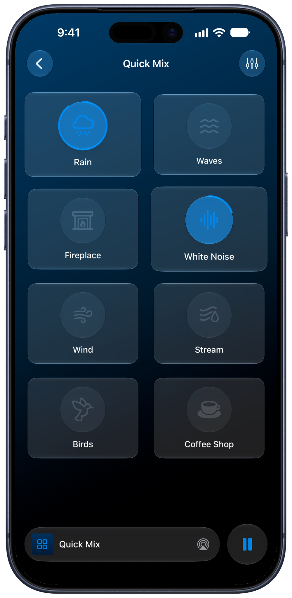
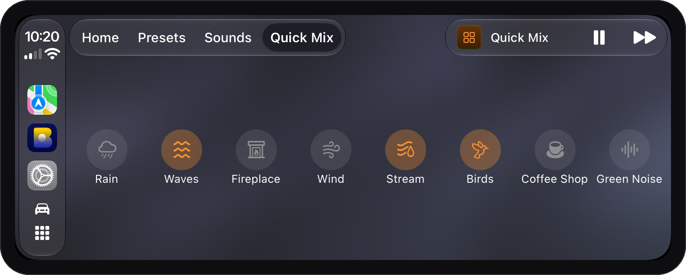
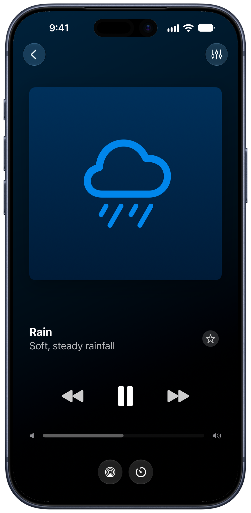
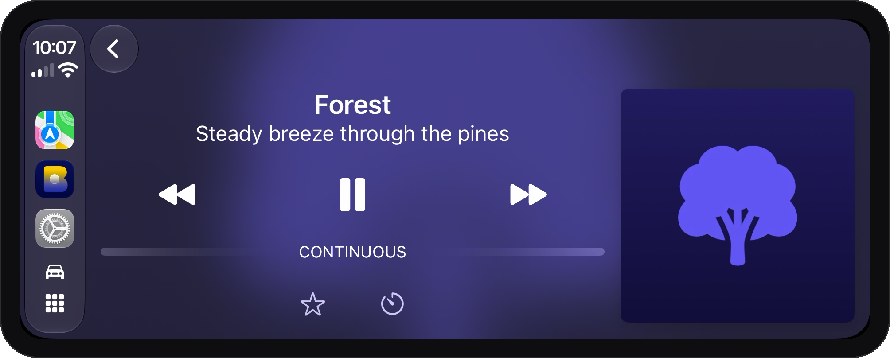

In Blankie you can listen to a saved preset, throw together a Quick Mix or play a single sound on its own. Switching to Quick Mix or a single sound never overwrites your saved presets.

## Presets

A [preset](/guides/create-and-manage-presets/) saves a group of sounds, their individual volumes and optional artwork and accent colors. Changes you make while a preset is selected save to it automatically.

Blankie also comes with a default preset called **All Blankie Sounds**, which includes every sound in your library (except ones marked **Preset Use Only**) so you have a full soundboard to test mixes on.

> [!TIP]
> On iPhone, selecting a preset opens **Now Playing** first by default, with the **Sound Mixer** button right below the volume slider. If you want presets to open directly to the sound grid, turn off **Open to Now Playing** in **Settings → Display**.

## Quick Mix

If you want to turn on rain and a fan quickly without editing a saved preset or scrolling through all 24 sounds, use **Quick Mix** on iPhone, iPad or CarPlay. It gives you a simple board of up to eight built-in or imported sounds:

- Tap **Quick Mix** at the top of your Library (or in the [CarPlay](/guides/blankie-carplay/) tab bar) and tap any tile to toggle it on or off.
- Quick Mix always opens straight to its tiles. When you switch back to a saved preset later, that preset is still the way you left it.
- To choose which eight sounds appear on the board or change their order, open Quick Mix and tap the edit button in the toolbar.

You can also add the **Quick Mix widget** to your Home Screen ([Control Blankie from Anywhere](/guides/control-blankie-anywhere/)). On iOS 27, the portrait **XL Quick Mix** widget puts **−** and **+** buttons next to each sound so you can adjust individual volumes in 5% steps from your Home Screen.

## Single sounds

To play **White Noise**, **Rain** or **Warm Piano** with nothing else mixed in, select any sound under **Sounds** in your Library:

- Blankie plays that sound on its own and shows its icon and subtitle (such as "Soft, steady rainfall") in Now Playing, on the Lock Screen and in CarPlay.
- Your saved presets stay untouched.
- Tap the **star** {{icon:star}} next to any sound in your Library to add it to **Favorites** alongside your starred presets. Starred sounds appear in the **Favorites** widget, on CarPlay's **Home** tab and when you press Previous or Next on your headphones or keyboard.
- Asking Siri to ["Start a sound in Blankie"](/guides/control-blankie-anywhere/) also starts that sound on its own.

## Related guides

- [Create and Theme Presets](/guides/create-and-manage-presets/)
- [Control Blankie from Anywhere](/guides/control-blankie-anywhere/)
- [Blankie on CarPlay](/guides/blankie-carplay/)
