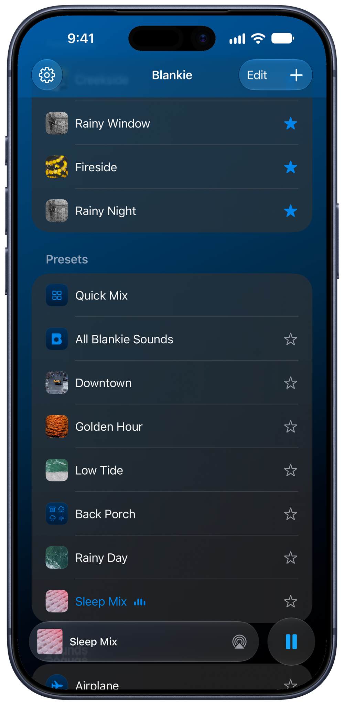

Mixed something worth passing along? Blankie saves any preset you've made as a single **.blankie** file. AirDrop it, message it or email it to anyone else running Blankie.

## What's inside a .blankie file

Everything it takes to rebuild your preset, the way you mixed it:

- The preset's sounds, volume levels, name, creator and artwork
- Any **custom sounds** the preset uses. The actual audio files ride along too, with their icons, loudness settings and credits, so whoever opens it hears what you hear.

## Export a preset

1. Right-click the preset on Mac (or touch and hold on iPhone and iPad) and choose **Edit Preset**.
2. Click the **share** {{icon:share}} button in the toolbar, or press {{kbd:⌘ E}} on Mac while the preset is active.
3. Send it however you like: [AirDrop](https://support.apple.com/guide/iphone/use-airdrop-to-send-items-to-nearby-devices-iphcd8b9f0af/ios), Messages, Mail or just save the file for later.

You can share any custom preset you build.

## Import a preset someone sent you

- **On iPhone or iPad:** tap a `.blankie` file in Messages or the [Files app](https://support.apple.com/guide/iphone/files-basics-iphe9d46e90f/ios) to see a Quick Look preview of the preset's artwork, creator and sound count, then open it in Blankie with the share button. Or tap {{icon:plus|Add}} **→ Import** in your Library and pick the file yourself.
- **On Mac:** double-click the `.blankie` file in Finder, choose **File → Import**, or press {{kbd:⌘ I}} and select the file.

Blankie adds the preset to your Library and switches right to it. Any custom sounds bundled inside install on their own. If you already have a preset with the same name, the new one gets a numbered name so nothing gets overwritten.

## Related guides

- [Create and Theme Presets](/guides/create-and-manage-presets/)
- [Import Your Own Sounds on iPhone & iPad](/guides/import-sounds-iphone-ipad/)
- [Can you sell Blankie sound packs?](/guides/sell-sound-packs/)
