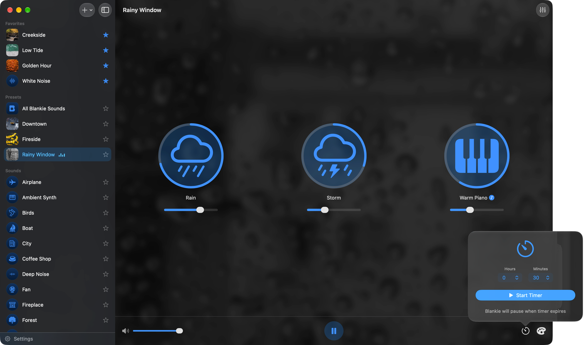
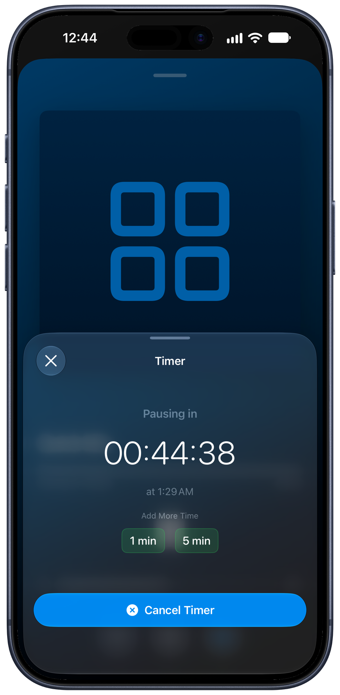
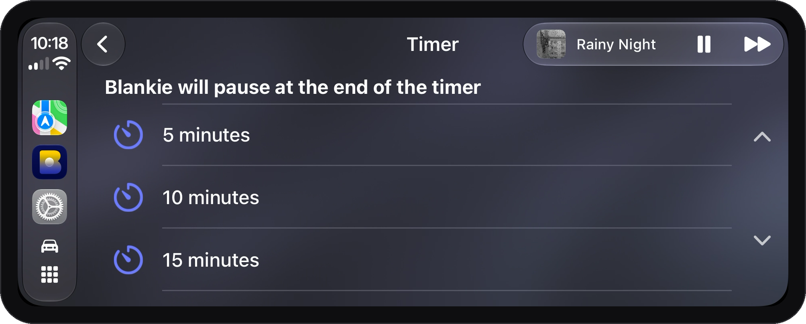
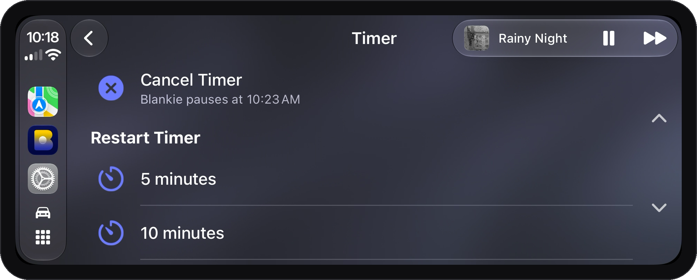

Falling asleep to rain or ocean waves is lovely. Having it run until morning isn't. Blankie's sleep timer pauses playback for you, so your soundscape clocks out when you do.

## On Mac

1. Click the **timer** {{icon:timer}} button in the control bar at the bottom of the window.
2. Set hours and minutes, then click **Start Timer**.

Once it's counting down, the timer icon picks up your accent color and the window subtitle reads **"Pausing at [time]."** Changed your mind? Open the timer again and click **Cancel Timer**.

## On iPhone or iPad

1. Open the **Now Playing** screen.
2. Tap the **Timer** {{icon:timer}} button (under the volume on iPhone).
3. Set hours and minutes, then tap **Start Timer**.

Now Playing shows the countdown and **"Pausing at [time]"** while it runs. From the timer sheet you can also:

- **Add more time**: tap **+1 min** or **+5 min** to stretch a running timer instead of starting over
- **Cancel Timer**: stop the countdown and keep the sound going

## In CarPlay

1. Open **Now Playing** on the dashboard and tap **Sleep Timer** {{icon:timer}}.
2. Pick a length from the list.

While it runs, the same button shows when Blankie will pause. Tap **Cancel Timer** to stop it, or pick a new length under **Restart Timer** to start over.

## With Siri or Shortcuts

On iPhone and iPad, say **"Start a sleep timer in Blankie,"** then tell Siri how many minutes you want. Say **"Cancel Blankie sleep timer"** to cancel the countdown while keeping your sounds playing.

In Shortcuts on Mac, iPhone or iPad, add Blankie's **Start Sleep Timer** action and set **Minutes** to a value from 1 to 480. Use **Stop Sleep Timer** to cancel it. Starting a timer sets when playback will pause; use a Play or Play Preset action first if you also want the shortcut to start your sounds.

## What happens when time's up

Playback pauses, and that's it. Your sounds and volumes stay exactly where you left them, so a tap on play in the morning brings your mix back just as it was.

## Related guides

- [Create and Theme Presets](/guides/create-and-manage-presets/)
- [Turn Voice Memos Into Ambient Sounds](/guides/import-voice-memos/)
- [Custom Sound Settings: Loop, Sound Check & Credits](/guides/custom-sound-settings/)
