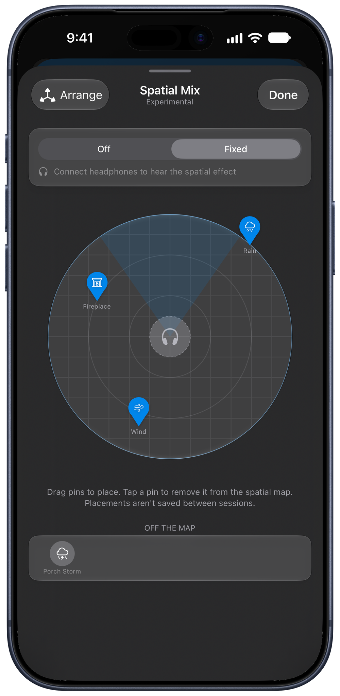

With headphones on, Blankie's experimental **Spatial Audio Mixing** lets you place the sounds in a preset around you on a 3D map, such as rain out in front, a fireplace to your left and wind farther back in the trees.

## Turn on Spatial Audio Mixing

1. Open **Settings** ({{icon:settings|Settings}} in your Library or {{kbd:⌘ ,}} on Mac).
2. Under **Playback & Sounds**, turn on **Spatial Audio Mixing**.

Turning this on adds a **Spatial Mix** button to your presets.

## Place sounds around you

1. Open a preset with a few sounds playing and tap or click the **Spatial Mix** button.
2. At the top of the Spatial Mix view, switch from **Off** to **Fixed** (or **Head Tracked** when compatible AirPods are connected).
3. Drag each sound's pin around the circular map. Moving a pin around the circle changes its direction; dragging it closer to or farther from the center changes its distance (from half a meter out to three meters).

Two controls on the map help you adjust the layout:

- **Arrange:** if your pins are stacked on top of each other, tap **Arrange** to spread every active sound evenly around the circle.
- **Off the Map:** tap any pin on the map to take it out of 3D space and move it to the **Off the Map** row below. A sound in **Off the Map** plays normally in stereo while the rest of your mix stays placed around you. Tap it again to put it back on the map.

## Fixed vs. Head Tracked

- **Fixed** renders the 3D binaural space on any wired or wireless headphones. When you turn your head, the soundstage moves with you.
- **Head Tracked** is available when you're wearing compatible AirPods and have granted Motion permission. It anchors your sounds in the room, so turning your head to the right points you toward the sounds placed on your right. A shaded wedge on the map rotates live to show the direction you're facing. If you take your AirPods out mid-session, Blankie switches back to **Fixed** without interrupting playback.

## Session-only placement

Spatial placements apply to your current listening session only and reset when you turn Spatial Mix off. Your saved preset's sounds and volume sliders stay unchanged.

## Related guides

- [Create and Theme Presets](/guides/create-and-manage-presets/)
- [Play Blankie Alongside Music, Podcasts or Audiobooks](/guides/mix-with-other-audio/)
- [Control Blankie from Anywhere](/guides/control-blankie-anywhere/)
