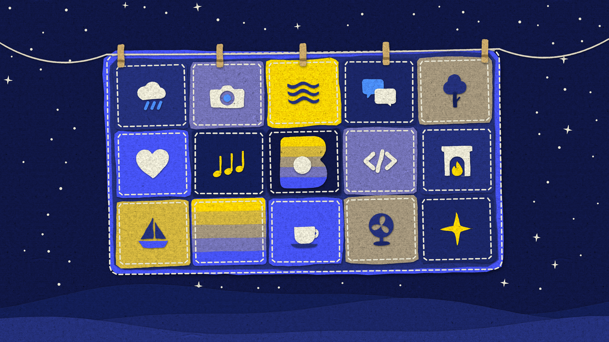

Blankie is free because I wanted to make something I could share, and I never wanted money to be a reason someone didn't get to benefit from what I built. I'm [Cody Bromley](https://github.com/codybrom), the independent developer who makes Blankie, and keeping it free felt even more important because I get to benefit from the work of so many other people I never paid.

## It started with Blanket on a little Linux box

After I finished my master's degree, I decided to repurpose the computer I'd bought for school into a Linux machine. I wasn't very familiar with using Linux outside of managing servers for work here and there, and I wanted to get comfortable using it every day.

One of the first apps I found myself using was [Blanket](https://github.com/rafaelmardojai/blanket), an open-source ambient sound app by Rafael Mardojai and its contributors. To me, it was and remains perfect. What Rafael and the contributors have put together is everything you need, with no cruft whatsoever. For a couple of years, I used my little Lenovo Linux box as my main desktop PC, and almost any time I was at my desk using it, I'd have Blanket running.

While I had a nice time with Linux, I've always been an Apple user at heart. I grew up using Apple computers at school, and the first computer I ever bought myself was a MacBook Pro. I've used a Mac at home or at work for going on 20 years, and two Christmases ago I was gifted a brand-new Mac mini. It was well timed because my little Linux box, while still plenty fast, was about nine years old and out of moves on the upgrade front.

I was excited to have a desktop Mac at home again, but after moving all my files and setting up my workspace, I found myself missing Blanket a lot. It had just become part of the background of working at my desk. I've tried a few other ways to listen to ambient sounds over the years. For a while I had a complimentary subscription to one of the big sleep apps and I've paid for others in the past. I even have a 35-minute rain track in my iTunes library that I downloaded somewhere back in 2010. I've also tried Spotify and YouTube, but I've learned the hard way that listening to ambient sounds on a service with algorithmic recommendations wrecks your recommendations. A friend of mine was surprised to find out one year in her Spotify Wrapped that her top artist was chanting Gregorian monks, because that's what she liked to listen to on a loop when she slept. It was clear to me that I needed a dedicated ambient sound app, and so did many others around me.

## From Blanket to Blankie

Blankie started life as a pure port of Blanket. I loved Blanket on my Linux box, so I didn't want an app that was "kind of" like it. I just wanted Blanket on my Mac.

The primary concepts of Blanket are so solid, clear and well designed that bringing them over went pretty fast. The more I used it, though, the more I realized there were a few things here and there that it was missing to feel like a proper Mac app. As I kept working around the edges and talking to people about the kinds of features they'd been looking for in an app like it, Blankie began to take shape. Pretty soon people started asking me when it would come to iPhone and then I had to start all over, because Blanket was designed for a desktop, not your finger.

I'm a bit of a nomad when it comes to programming languages, though I've spent most of my time on web stacks. More than anything, I always wanted to build a native app for an Apple platform.

There have always been ways to sort of do that using web technologies like React Native, Ionic, Cordova or PhoneGap, but the times I'd done that for clients always left me with apps that felt underwhelming and underperformant. I knew an app could be better and feel better, and I just hadn't put in the time. Blankie was the first time I had a complete enough thought that I felt motivated to push through that knowledge gap, learn Swift and build something I didn't know how to build before.

## Charging for Blankie never crossed my mind

When I bought that first MacBook Pro, the first thing I did was load it up with a ton of cool freeware that people had made. Somewhere in the last 20 years, most of that cool freeware either vanished or became subscription software. I get it. It's hard out there for developers, and if you're going to sink hundreds or thousands of hours into something, it should probably have some kind of payoff.

Charging has never once entered my mind for Blankie, though. For starters, Blanket is free and open source. Making a port or even a spiritual sibling of Blanket that I charged for just feels wrong. It only made sense to me that Blankie also be open source, and to me, the best kind of open is also free.

A lot of people's efforts have contributed to Blankie, from photographers and sound recordists to translators and other programmers. Most of them chose to release their work freely with permissive licenses so their work could be enjoyed by others (you can find them all on the [Credits](/credits/) page). Keeping Blankie free is how I pass that along.

## Reaching more people is the payoff

I know I'm leaving money on the table, but I'd just rather there be more seats at this table. People tell me I'm crazy for not charging, and I still think the fact that more people can and will try Blankie makes it worth it. Blankie has been downloaded more than 25,000 times, and that's way cooler to me than whatever money it might have made.

Seeing the reviews flood in from all over the world is such a gift. The other day I saw an educational institution in Belgium had installed Blankie across a bunch of devices, and that blew my mind. I fell in love with Apple computers at school as a kid, and now, seeing that some kids might use Blankie and play around with it on their school computers means the world to me.

Making people happy and helping people find rest and relaxation is worth a lot to me. If you'd like to help out anyway, the [FAQ](/faq/#is-blankie-free) lists a few ways to support Blankie, and none of them cost a cent.

## Related guides

- [Get Started with Blankie](/guides/get-started/)
- [Where to Find Free Ambient Sounds](/guides/find-free-ambient-sounds/)
- [Common Sound Licenses, Explained](/guides/sound-licenses-explained/)
